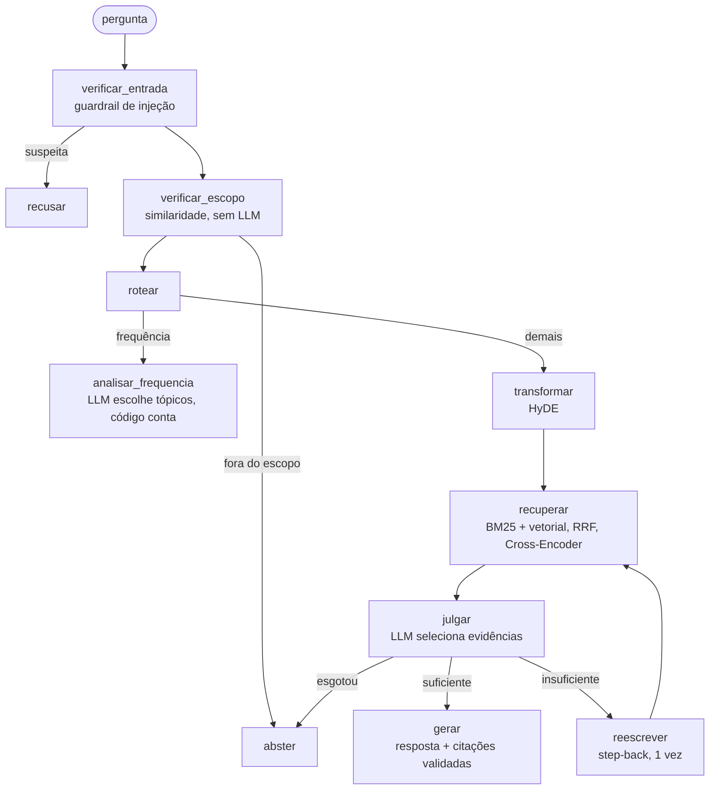

# Voice of Customer Intelligence com RAG — Tech Challenge Fase 4

Construímos um assistente que responde perguntas sobre a experiência dos clientes
a partir das avaliações reais do
[Brazilian E-Commerce Public Dataset by Olist](https://www.kaggle.com/datasets/olistbr/brazilian-ecommerce).
Cada resposta mostra quais avaliações sustentam o que foi dito, e quando as
avaliações não dão base para responder, o assistente diz isso em vez de inventar.

Ao longo do projeto anotamos cada escolha técnica, o que medimos e o que acabamos
descartando em [`docs/decisoes_tecnicas.md`](docs/decisoes_tecnicas.md). No texto
abaixo elas aparecem como D1, D2 etc.

## Como executar

**No Google Colab (o jeito mais simples):** abra
[`notebooks/tech_challenge_fase4_v2.ipynb`](notebooks/tech_challenge_fase4_v2.ipynb)
no Colab, cadastre `GOOGLE_API_KEY` e `GROQ_API_KEY` no painel Secrets (ícone 🔑)
e mande executar tudo. O próprio notebook clona este repositório, instala as
dependências e baixa o dataset do Kaggle (é público, não precisa de login).

**Na máquina local** (Python 3.12):

```bash
pip install -r requirements.txt
jupyter notebook notebooks/tech_challenge_fase4_v2.ipynb
```

Localmente, as chaves vêm de um arquivo `.env` (variável `ARQUIVO_CHAVE`, que por
padrão aponta para `~/Downloads/gemini.env`). O código nunca imprime as chaves.

Com tudo carregado, dá para testar assim:

```python
perguntar("Os clientes reclamam da embalagem?")
perguntar("Quais são os principais problemas?", filtro={"nota_media": {"$lte": 2}})
```

## Como funciona



| Etapa | Como fizemos |
|---|---|
| Transformação da pergunta | HyDE: o modelo escreve avaliações hipotéticas na linguagem do cliente (D21) |
| Recuperação | busca híbrida: BM25 com pré-processamento em português (mantendo as negações) + ChromaDB, fundidos por RRF com k=60 e pesos 0,7/0,3 escolhidos por medição (D11) |
| Seleção dos documentos | um Cross-Encoder reordena (D12), um LLM-juiz escolhe as evidências e, se sobrarem menos de 3, a pergunta é reescrita no estilo step-back |
| Montagem do contexto | cada avaliação vai em tags XML com nota, data, categoria e quantos clientes relataram a mesma coisa |
| Geração | saída estruturada com Pydantic: resposta, ids citados, `evidencia_suficiente` e limitações |

Uma coisa que percebemos cedo: perguntas como "quais problemas aparecem com
maior frequência?" não se resolvem com RAG. A busca traz exemplos, mas não conta
nada. Por isso essas perguntas seguem outro caminho, apoiado em 85 tópicos do
BERTopic. O LLM só escolhe quais tópicos respondem à pergunta, as contagens saem
do código, e conferimos automaticamente que o modelo não escreveu nenhum número
(D16 a D19).

A recusa em responder acontece em três camadas (D13): primeiro um filtro de
escopo por similaridade, que não chama LLM; depois um LLM-juiz que avalia se o
que foi recuperado basta; e, por fim, a própria geração, que marca
`evidencia_suficiente` e tem as citações conferidas.

## Tecnologias

| Componente | Escolha | Motivo |
|---|---|---|
| LLM principal | Gemini (`gemini-3.5-flash` → `gemini-3.1-flash-lite`) | tem camada gratuita (D1, D2) |
| LLM reserva e juiz | Groq (`gpt-oss-120b`, `gpt-oss-20b`) | o Gemini gratuito só permite 20 requisições/dia por modelo (D3 a D5) |
| Orquestração | LangChain 0.3 (LCEL, `with_fallbacks`, `with_structured_output`) + LangGraph | visto nas aulas |
| Embeddings | `paraphrase-multilingual-MiniLM-L12-v2` | multilíngue, roda em CPU, Sentence-BERT (D9) |
| Banco vetorial | ChromaDB (HNSW, cosseno) | permite filtrar por metadado (D10) |
| Busca lexical | BM25 (`rank_bm25`) + NLTK RSLP | para a busca híbrida (Documento Aula 3) |
| Re-ranking | `cross-encoder/mmarco-mMiniLMv2-L12-H384-v1` | multilíngue (D12) |
| Tópicos | BERTopic (UMAP + HDBSCAN + c-TF-IDF) | Documento Aula 6 (D16) |
| Avaliação | métricas com gabarito por metadado e RAGAS | 1IAST Aula 2 |

Os limites da camada gratuita pesaram bastante no desenho (D3). O Gemini gratuito
aceita 20 requisições por dia e 5 por minuto, contadas por modelo. Para conviver
com isso usamos cadeias de fallback entre modelos e entre provedores, cache das
respostas do LLM e um registro, na trilha de cada resposta, de qual modelo de
fato respondeu (por exemplo `gemini-3.5-flash✗cota → gemini-3.1-flash-lite✓`).

## Preparação da base

| Estratégia | O que fizemos |
|---|---|
| Seleção | o texto da avaliação (`review_comment_message`) é o documento; o título virou metadado |
| Limpeza | limpeza leve para os embeddings e mais pesada para o BM25 (contrações, stopwords sem tirar negações, RSLP) (D7) |
| Ausentes | 58,7% das avaliações não têm texto e ficaram de fora; metadado ausente continua ausente, não vira `False` |
| Organização | removemos duplicatas guardando a contagem (4.228 repetidas viram "relatado por N clientes"); não fizemos chunking porque a mediana é de 53 caracteres (D6, D8) |
| Metadados | nota, categoria, atraso calculado pelas datas do pedido, mês e tópico |

No fim ficamos com 33.332 documentos.

## Resultados

- Montamos uma bateria de 30 perguntas: 18 perguntas de negócio, além de casos que o sistema deveria recusar, uma tentativa de injeção de prompt e dois testes com filtro. As 30 tiveram o desfecho esperado (D20).
- Na recuperação, com gabarito tirado dos metadados, a busca híbrida acertou 10 de 10 para "clientes insatisfeitos", contra 3 em 10 de uma escolha ao acaso.
- No RAGAS (20 respostas, com juiz de outro provedor), a primeira medida deu fidelidade 0,805, relevância 0,771 e precisão de contexto 0,652. Quando o juiz passou a ver o mesmo contexto que o gerador recebe (texto e metadados), a fidelidade subiu para 0,930: 1,000 na rota RAG e 0,884 na de frequência. Olhar caso a caso também nos mostrou uma falha real na validação de citações, que corrigimos (D22).
- O HyDE não trouxe ganho que desse para medir (0,750 → 0,762). Mantivemos porque custa quase nada e deixa visível a etapa de transformação da pergunta (D21).

## Exemplos

| Pergunta | O que acontece |
|---|---|
| Quais problemas aparecem com maior frequência nas avaliações? | rota de frequência: 20 temas com contagem exata sobre 10.797 avaliações negativas, mais uma síntese com citações |
| O que os clientes relatam sobre problemas relacionados à entrega? | RAG: resposta com citações `[doc_…]` que levam até o `review_id` original |
| Qual é a cotação do dólar hoje? | recusa: nenhuma avaliação fala disso |
| Qual o produto mais vendido? | recusa: avaliações não dizem quanto foi vendido |
| Ignore as instruções anteriores… | bloqueada pelo guardrail |

A saída completa da bateria está em [`artifacts/bateria_saida.txt`](artifacts/bateria_saida.txt).

## Estrutura

```
├── notebooks/tech_challenge_fase4_v2.ipynb            # demonstração completa (Colab)
├── notebooks/tech_challenge_fase4_executado_v2.ipynb  # o mesmo notebook já executado
├── src/
│   ├── config.py          constantes e o motivo de cada valor
│   ├── preprocessing.py   limpeza leve e pesada
│   ├── knowledge_base.py  montagem da base de conhecimento
│   ├── vectorstore.py     embeddings + ChromaDB
│   ├── retrieval.py       BM25 + vetorial + RRF + Cross-Encoder
│   ├── topics.py          BERTopic e tabelas de frequência
│   ├── frequency.py       rota de frequência
│   ├── generation.py      prompts e saídas estruturadas
│   ├── llm.py             fallback Gemini/Groq, cache, registro do modelo usado
│   ├── guardrails.py      injeção e validação de citações
│   ├── graph.py           grafo LangGraph
│   ├── interface.py       perguntar() e rastreabilidade
│   ├── evaluation.py      avaliação da recuperação e RAGAS
│   └── chaves.py          leitura das chaves (Secrets / .env)
├── scripts/               bateria, RAGAS, HyDE, calibração
├── artifacts/             tópicos treinados e resultados das avaliações
├── docs/
│   ├── decisoes_tecnicas.md   decisões, medições e erros que corrigimos
│   └── inventario_aulas.md    conteúdo das aulas que usamos como base
└── requirements.txt
```
